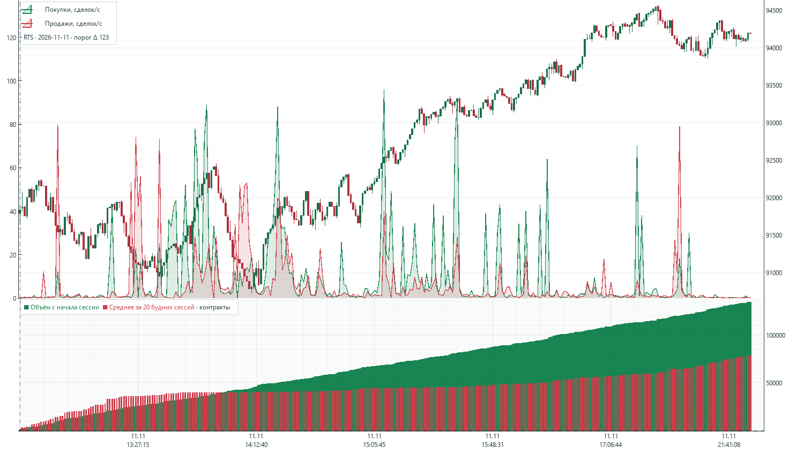

# График адаптивных дельта-баров Finam

`chart.py` строит график RTS или MIX по тикам Finam, сохраняет результат по дням и при повторном открытии загружает готовые свечи из SQLite. На верхней панели показаны свечи и две интенсивности на независимой левой шкале. На нижней панели можно сравнить, сколько контрактов прошло от начала дня до каждой свечи и сколько обычно проходит к этому времени. Колесо мыши меняет масштаб, курсор показывает московское время закрытия и значения индикаторов.



## Запуск

Команды для PowerShell из корня `pj31_delta_ts`. Используется локальное окружение `.venv`. Перед первым запуском установите зависимости командой `.\.venv\Scripts\python.exe -m pip install -r requirements.txt`. Исходный код алгоритма по-прежнему берётся из соседнего `pj24_delta_bars`.

```powershell
$python = '.\.venv\Scripts\python.exe'
& $python .\finam_delta_bar_chart\chart.py
& $python .\finam_delta_bar_chart\chart.py --symbol MIX --date 2026-11-11
& $python .\finam_delta_bar_chart\chart.py --symbol RTS --start 2026-11-09 --date 2026-11-11
& $python .\finam_delta_bar_chart\chart.py --start 2016-11-09 --date 2026-11-11
& $python .\finam_delta_bar_chart\chart.py --input-root C:\data_quote --date 2026-11-11 --png RTS.png
& $python .\finam_delta_bar_chart\chart.py --backtest --symbol RTS --date 2026-11-11
& $python .\finam_delta_bar_chart\chart.py --backtest --symbol MIX --start 2026-11-09 --date 2026-11-11 --trades .\mix-november.csv
```

| Параметр | Назначение |
| --- | --- |
| `--symbol RTS` или `--symbol MIX` | Выбор инструмента. По умолчанию RTS. |
| `--date ГГГГ-ММ-ДД` | Последняя отображаемая сессия. По умолчанию берётся самая свежая дата с тиками. Для явно указанной даты нужен непустой архив. |
| `--start ГГГГ-ММ-ДД` | Первый день диапазона включительно. По умолчанию показывается одна сессия. |
| `--input-root ПАПКА` | Общий корень каталогов исходных ZIP и дневного кэша. По умолчанию `C:\data_quote`. |
| `--png ФАЙЛ` | Сохранить изображение в существующую папку. При запуске без этого параметра открывается интерактивное окно. |
| `--backtest` | Запустить ручной бэктест на выбранном диапазоне. Взаимоисключающий режим с `--png`. |
| `--trades ФАЙЛ` | Задать путь нового CSV позиций для `--backtest`. Относительный путь считается от текущей папки PowerShell. |

## Ручной бэктест

Окно открывается на первом баре выбранного диапазона. Синяя черта отмечает цену открытия. На этом шаге известны только время и цена первого тика бара. Следующий шаг раскрывает свечу, интенсивности и накопительные объёмы. Колесо мыши меняет масштаб. Команды доступны с клавиатуры и кнопками вверху окна.

Под графиком в одной строке слева постоянно видны показатели последнего завершённого бара, справа — бара под мышью на любой из двух панелей. Для завершённого бара показаны его номер, московское время закрытия, дельта и порог, покупки и продажи в сделках за секунду. «Объём − среднее» равен накопленному объёму с начала сессии минус средний объём к тому же времени, в контрактах. Положительное значение означает превышение среднего, отрицательное — отставание. При наведении на текущее открытие доступны только номер, время и цена. Обе части строки обновляются при перемотке.

| Клавиша | Действие |
| --- | --- |
| `→` | Раскрыть текущую свечу и перейти к открытию следующей. На последнем баре показывает его итог и завершает диапазон. |
| `←` | Убрать текущий бар и все входы на нём. Если на нём были выходы, ранее открытые позиции снова становятся открытыми. Возврат с конца диапазона сначала показывает открытие последнего бара. |
| `↑` | Купить один контракт по цене открытия текущего бара. Каждое нажатие создаёт отдельную позицию. |
| `↓` | Открыть отдельную короткую позицию на один контракт по цене открытия. Длинные и короткие позиции могут существовать одновременно. |
| `C` | Закрыть все открытые позиции по цене открытия текущего бара. Работает также клавиша «С» в русской раскладке. |

Шаг назад с первого бара убирает и его. Нажмите `→`, чтобы начать снова. После конца диапазона и до первого бара торговля недоступна. Оставшиеся открытыми позиции сохраняются в файле с пустыми полями выхода. Перемотка вперёд после отмены позволяет принять новое решение на том же баре.

Таблица под графиком показывает все 16 полей CSV и дополнительную колонку «Открытый PnL, п.» рядом с «Закрытый PnL, п.». Наведите мышь на заголовок, чтобы увидеть имя соответствующего поля CSV. Справа от PnL расположены объёмы и интенсивности при входе и интенсивности при выходе. Если таблица шире окна, используйте горизонтальную полосу прокрутки. Прочерк обозначает пустое значение, а нулевая интенсивность отображается числом. Над таблицей видны два итога в пунктах цены.

- **Открытый (нереализованный) PnL** меняется при каждом шаге вперёд и назад. Цена оценки равна открытию текущего бара. После раскрытия последней свечи используется её закрытие. Например, покупка по 100,1 при текущем открытии 102,4 показывает +2,3 пункта, продажа по той же цене входа — −2,3 пункта.
- **Закрытый (реализованный) PnL** фиксируется по цене выхода при нажатии `C`. Результат переносится из открытого итога в закрытый. При отмене закрытия позиция снова оценивается по цене видимого шага.

Оба итога рассчитаны для одного контракта на позицию без комиссий и денежной стоимости пункта.

### Файл позиций

`backtest.py` ведёт состояние прогона, оценивает позиции и сохраняет в CSV индикаторы на входе и выходе. Файл обновляется после входа, закрытия или отмены сделки. `backtest_window.py` отображает доступные бары, обрабатывает кнопки и клавиатуру и обновляет оба вида PnL. Оба модуля запускаются через `chart.py --backtest` с параметрами из раздела «Запуск».

По умолчанию файл создаётся в папке `backtests` рядом с `chart.py`, например `backtests/RTS_2026-11-11_2026-11-11.csv`. Для повторного прогона автоматически выбирается свободное имя с суффиксом `_2`, `_3` и далее. Путь показан внизу окна. При явном `--trades` укажите свободное имя. Если файл занят Excel во время работы, закройте его и повторите команду в бэктесте. При ошибке записи состояние позиций и курсор сохраняются на предыдущем шаге.

CSV использует UTF-8 с BOM, разделитель — запятая, десятичный знак — точка. Одна строка соответствует одной позиции.

| Поля | Содержимое |
| --- | --- |
| `position_id`, `symbol`, `side` | Номер позиции в прогоне, инструмент и направление (`BUY` или `SELL`). |
| `entry_bar`, `entry_time`, `entry_price` | Номер, московское время открытия и цена бара входа. Бары нумеруются с 1 от начала диапазона, включая переходы между днями. |
| `exit_bar`, `exit_time`, `exit_price` | Соответствующие данные бара выхода. У открытой позиции поля пусты. |
| `pnl_points` | Реализованный PnL в пунктах. У открытой позиции поле пустое, при закрытии по цене входа записывается ноль. |
| `entry_daily_volume` | Накопленный с начала сессии объём в контрактах (зелёный столбец). |
| `entry_mean_volume` | Средний накопленный объём к тому же времени за 20 предыдущих будних сессий (красный столбец). |
| `entry_buy_rate` | Интенсивность покупок, сделок в секунду. |
| `entry_sell_rate` | Интенсивность продаж, сделок в секунду. |
| `close_buy_rate` | Интенсивность покупок перед выходом, сделок в секунду. |
| `close_sell_rate` | Интенсивность продаж перед выходом, сделок в секунду. |

Четыре индикатора фиксируются при входе по **предыдущему завершённому бару той же московской сессии**. Например, при входе на открытии бара № 8 записываются показания бара № 7. При входе на первом баре сессии эти поля пусты. При закрытии и отмене закрытия сохранённые показания остаются привязаны к исходному входу. Нереализованный PnL отображается в окне.

При нажатии `C` в обе колонки `close_*` для каждой закрываемой позиции записываются интенсивности последнего завершённого бара той же сессии. У открытых позиций и при выходе на первом баре сессии эти поля пусты. Если шаг назад отменяет выход, его интенсивности также очищаются.

## Дневной кэш

При первом открытии диапазона скрипт создаёт базу выбранного инструмента. Каждая запись содержит все свечи одного дня, включая дневной остаток, порог, интенсивности покупок и продаж, текущий и средний накопительные объёмы. Запись завершается сразу после расчёта дня, ещё до открытия окна или сохранения PNG.

| Инструмент | База по умолчанию |
| --- | --- |
| RTS | `C:\data_quote\delta_bar_finam_RTS\chart.sqlite3` |
| MIX | `C:\data_quote\delta_bar_finam_MIX\chart.sqlite3` |

Обычная команда запуска подходит для первого расчёта, повторного просмотра и продолжения после остановки. Можно выбрать часть сохранённого диапазона или расширить его. Для первого дня, требующего расчёта, скрипт восстанавливает историю по исходным тикам 20 предыдущих будних сессий.

Модуль `day_cache.py` хранит сжатые данные и подпись исходников в одной транзакции SQLite на день. При проверке записи он читает из каталога ZIP размер и CRC файла CSV. Подпись учитывает ZIP самой сессии, даты и содержимое будних архивов в её историческом окне и версию расчёта. При исправлении, добавлении или удалении архива затронутые записи пересчитываются при запросе. Поэтому исходные ZIP нужны и при повторном просмотре. При полностью сохранённом диапазоне для графика достаточно прочитать готовые свечи и проверить каталоги ZIP.

## Ход расчёта

При обычном запуске и при сохранении PNG консоль показывает ход загрузки.

- **История** появляется, когда для первой даты требуется прогрев. Она показывает, сколько из 20 предыдущих будних сессий со сделками уже подготовлено для расчёта порога дельты и среднего объёма. Архивы просматриваются от новых к старым.
- **Диапазон** показывает дату и операцию — чтение из кэша, подготовку истории, чтение тиков или расчёт свечей и индикаторов. Пустой архив тоже учитывается как обработанный. В конце строки «готово» указано число дней, взятых из кэша.

После первой выполненной единицы каждого этапа справа появляется примерное оставшееся время в формате `ЧЧ:ММ:СС`. Оно пересчитывается по средней скорости этого этапа и может меняться из-за разного количества сделок в архивах. После обработки диапазона скрипт сообщает число свечей и приступает к построению графика.

## Расчёт свечей

В текущей `.venv` из установленного `finplot/__init__.py` удалён блок
проверки локали, принудительно завершающий процесс при русской локали Windows.
Переустановка Finplot 1.9.7 восстановит этот блок; обычной установки пакетов
для такой локали недостаточно.

Скрипт использует исходные функции `pj24_delta_bars/source/delta_core.py` и поиск файлов из `tick_to_delta_bars.py`. Папки проектов должны лежать рядом. Для каждого инструмента нужен свой архив.

- RTS — `C:\data_quote\data_finam_RTS_tick_zip\YYYYMMDD.zip`.
- MIX — `C:\data_quote\data_finam_MIX_tick_zip\YYYYMMDD.zip`.

На каждую дату алгоритм подбирает порог по **20 предыдущим будним дням со сделками**. Цель калибровки — число непустых пятиминутных интервалов за эти дни. Свеча закрывается на первой целой сделке, доведшей абсолютную дельту до порога. Дневной остаток также отображается. На графике у каждой свечи своя позиция, включая свечи, закрывшиеся одновременно. Подписи оси X показывают фактическое время закрытия.

Для расчёта нового дня нужна полная история калибровки. Скользящие окна хранятся в памяти, а готовый день записывается в дневной кэш. Расчёт запускается из самого просмотрщика.

## Интенсивность покупок и продаж

Зелёная линия показывает число сделок покупки за секунду на данном баре, красная — число сделок продажи за секунду. Каждая сделка учитывается один раз независимо от размера. За длительность взята разность между временем последнего и первого тика бара в целых секундах, с минимумом в одну секунду. В архивах Finam дробные части времени могут служить для упорядочивания сделок внутри секунды.

В CSV есть только время, цена и объём. Инициатор оценивается по изменению цены (`tick rule`), как в исходном проекте. Рост цены означает покупку, снижение — продажу, при равной цене сохраняется последнее направление. Первые сделки с одинаковой ценой до первого изменения нейтральны. Их объём входит в дневную сумму. Индикатор воспроизводит вид зелёной и красной кривых JatoTrader и использует единицы из примера `intensivnost_RTS.png`. Точная внутренняя формула JatoTrader по снимкам неизвестна.

## Накопительный объём

- **Широкий зелёный столбец на заднем плане** — сумма объёмов от начала московского календарного дня до сделки, закрывшей свечу, включительно. Более поздние сделки с той же меткой времени попадут в следующие бары.
- **Узкий красный столбец на переднем плане** — среднее арифметическое по 20 предыдущим будним сессиям со сделками. В каждой сессии берётся сумма объёмов всех тиков с московским временем **до времени закрытия текущей свечи включительно**. Если торги в прошлой сессии к этому времени ещё не начались, её вклад равен нулю. Если уже завершились, учитывается весь объём той сессии.

Средний объём и порог дельты используют одни и те же даты с понедельника по пятницу. При пропуске архива или буднем дне без сделок скрипт берёт более раннюю сессию, пока не наберётся 20. Торги в субботу и воскресенье отображаются на графике со своим текущим объёмом. До завершения следующей будней сессии набор исторических дат остаётся таким же, как в конце пятницы.

## Проверка

Из корня `pj31_delta_ts` можно проверить формулы и обработку одинаковых временных меток на небольших тестовых ZIP.

```powershell
.\.venv\Scripts\python.exe -m unittest discover -s tests -v
```
